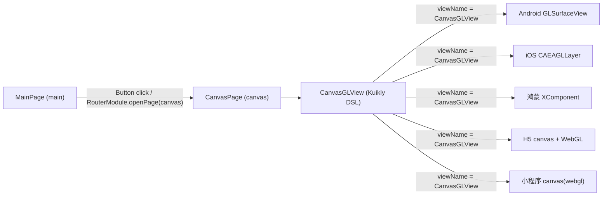

## 产品概述
在 Kuikly 跨端工程中新增「主页 → OpenGL 画布页」的完整链路：`MainPage` 作为 App 启动页，页面中间放一个按钮；点击后跳转到 `CanvasPage`，该页面铺满一个原生平台的 View，并在该 View 上用 OpenGL 绘制纯红色背景。要求五端（Android / iOS / 鸿蒙 / H5 / 微信小程序）都能正常打开并看到红色画面。

## 核心功能
- **MainPage（启动页）**：页面垂直水平居中一个可点击按钮，文字如「进入画布」；点击后通过路由跳转到 `canvas` 页面。
- **CanvasPage（画布页）**：页面内铺满一个原生 GL 视图（占满整页，无留白、无滚动），视图内容为纯红色背景；进入页面即渲染，返回上一页时资源正常释放。
- **全平台一致**：五端使用同一个组件名，Kuikly 侧业务代码只写一次；各端分别用原生 OpenGL 能力实现红色清屏。
- **启动页统一切换**：Android / iOS / 鸿蒙 / H5 / 小程序的默认入口页由 `router` 改为 `main`。
- 视觉上除按钮外无额外装饰；`CanvasPage` 为整屏纯红。

## 边界与约定
- 原生 GL 视图为独立渲染层，不做圆角、不做被其它视图半透明覆盖的效果，仅用于铺满整页。
- 其它已有页面（`router`、`image_adapter`）保持可用，不受影响。


## 技术栈
- 跨端 UI 框架：Kuikly `2.7.0-2.1.21`（Kotlin `2.1.21`，KMM，共享代码在 `shared/src/commonMain`）。
- 组件扩展机制：Kuikly Expand View（自定义 View）——Kuikly 侧继承 `DeclarativeBaseView`，各端宿主实现同名 View。
- Android：`GLSurfaceView` + OpenGL ES 2.0（`GLSurfaceView.Renderer`，`glClearColor(1,0,0,1)` + `glClear`）。
- iOS：Objective-C `UIView` + `CAEAGLLayer` + `EAGLContext`（OpenGL ES 2.0）。
- 鸿蒙：ArkTS `KuiklyRenderBaseView` + `XComponent(SURFACE)` 承载 OpenGL/WebGL 渲染（API 12，`compatibleSdkVersion = 5.0.0(12)`）。
- H5：Kotlin/JS + `<canvas>` 的 WebGL 上下文清屏。
- 小程序：Kotlin/JS 自定义 `canvas` 节点（`type="webgl"`）+ 微信基础库 ≥ 2.7.0。

## 实现方案

### 总体策略
采用 Kuikly 官方的 **Expand View** 机制，把「一个原生 GL 视图」抽象为跨端组件 `CanvasGLView`：
- Kuikly 侧只定义组件契约（`viewName` / `Attr` / 事件 / DSL 语法糖），业务页面写法与普通组件无异；
- 各端宿主按同一份契约各自实现原生渲染，通过 `viewName = "CanvasGLView"` 关联（iOS 通过类名运行时反射创建，因此类名必须完全一致）。

从而做到「页面只写一次、渲染各端原生」，符合项目现有 `KuiklyExpand` / `components` 目录的既有扩展实践。

### 关键决策
1. **组件名统一为 `CanvasGLView`**：Android/H5/小程序通过注册名关联，iOS 通过 `NSClassFromString(viewName)` 创建实例，名称不一致会在 iOS 直接断言失败，故必须五端一致。
2. **Android 使用 `GLSurfaceView`（用户已确认）**：代码量最小、GPU 直绘性能最好；代价是独立 Surface，不能做圆角/半透明叠加——与「铺满整页纯色」的场景完全匹配。
3. **静态画面用按需渲染**：Android 采用 `RENDERMODE_WHEN_DIRTY` 并在 `onSurfaceCreated/onSurfaceChanged` 中 `requestRender()`，避免默认的 60fps 无意义重绘（显著降低功耗）；H5/小程序只在尺寸变化时重绘一次，不跑常驻动画循环。
4. **页面铺满方式**：Kuikly 侧自定义 View 必须显式给定宽高，故用 `absolutePositionAllZero()` + `size(pagerData.pageViewWidth, pagerData.pageViewHeight)` 铺满，避免依赖 flex 导致自定义 View 不显示。
5. **启动页改造最小化**：只改各宿主入口的默认页名字符串（`router` → `main`），不改动路由框架与 `RouterPage`，回退成本极低。
6. **页面可见性一致性**：给 `MainPage` / `CanvasPage` 补 `supportInLocal = true`，与既有 `RouterPage` 保持一致，保证「本地内置包」模式下新页面也被打进产物。

### 页面与数据流


### 性能与可靠性
- 渲染开销：每端均为「一次清屏」级别的绘制（常数级），无逐帧循环、无 CPU 位图上传。
- 资源释放：Android 在 `onPause/onResume` 由宿主 Activity 生命周期驱动（`KuiklyRenderActivity` 已转发）；iOS 在 `dealloc` 释放 EAGL 上下文与 framebuffer；H5/小程序随节点销毁自动回收。
- 幂等与容错：`setProp` 只处理白名单属性，其余交回 `super`；GL 初始化放在 Surface/尺寸回调中，避免在未就绪时调用 GL 接口；H5/小程序取不到 WebGL 上下文时降级为普通纯色背景，保证页面不崩。
- 兼容性风险：iOS `pbxproj` 需登记新文件（否则编译不参与）；鸿蒙 WebGL 模块若在目标设备不可用，则回退 XComponent + native C++ EGL/GLES 实现。

## 架构设计
沿用项目现有分层，不引入新架构模式：
- **共享层（shared/commonMain）**：新增自定义组件契约 + 两个页面（UI 与路由）。
- **宿主渲染层（androidApp / iosApp / ohosApp / h5App / miniApp）**：各自实现原生 View 与注册，页面入口页名调整。
- **注册入口**：Android 在 `KuiklyRenderActivity.registerExternalRenderView`（当前为空方法）；鸿蒙在 `KuiklyViewDelegate.getCustomRenderViewCreatorRegisterMap`；H5/小程序在各自 `KuiklyWebRenderViewDelegator.registerExternalRenderView`；iOS 无需注册（按类名创建）。
- **两处需额外配置**：iOS 的 `project.pbxproj` 文件登记；小程序的 `componentsAlias` + `dist/base.wxml` 模板。

## 目录结构

```
glfwmobile/
├── shared/src/commonMain/kotlin/com/edwin/glfwmobile/
│   ├── canvas/CanvasGLView.kt        # [NEW] CanvasGLView 组件契约：继承 DeclarativeBaseView<CanvasGLViewAttr, CanvasGLViewEvent>，
│   │                                 #       viewName() 返回 "CanvasGLView"；Attr 提供 clearColor/red 等属性透传；提供 ViewRef 友好的 DSL 扩展函数
│   ├── MainPage.kt                   # [MODIFY] @Page("main", supportInLocal = true)；body 内垂直居中一个 Button（标题「进入画布」），
│   │                                 #       click 中 acquireModule<RouterModule>(...).openPage("canvas", JSONObject()) 跳转
│   └── canvas/CanvasPage.kt          # [MODIFY] @Page("canvas", supportInLocal = true)；body 内放 CanvasGLView，
│                                     #       absolutePositionAllZero() + size(pagerData.pageViewWidth, pagerData.pageViewHeight) 铺满
├── androidApp/src/main/java/com/edwin/glfwmobile/
│   ├── canvas/CanvasGLView.kt         # [NEW] 继承 GLSurfaceView 实现 IKuiklyRenderViewExport：setEGLContextClientVersion(2)、
│   │                                  #       Renderer 中 glClearColor(1,0,0,1)+glClear、renderMode=RENDERMODE_WHEN_DIRTY、
│   │                                  #       onSurfaceChanged 设置 glViewport 并 requestRender；setProp/call 走白名单+sper
│   └── KuiklyRenderActivity.kt        # [MODIFY] registerExternalRenderView 中 renderViewExport("CanvasGLView", { CanvasGLView(it) })；
│                                      #       默认 pageName 由 "router" 改为 "main"
├── iosApp/
│   ├── iosApp/KuiklyExpand/Views/CanvasGLView.h/.m  # [NEW] UIView<KuiklyRenderViewExportProtocol>，layerClass 返回 CAEAGLLayer，
│   │                                  #       EAGLContext(ES2) + renderbuffer/framebuffer，layout 后 glClearColor 红色清屏并 present；
│   │                                  #       类名必须为 CanvasGLView；实现 setCss_/css_ 约定与 hr_rootView
│   ├── iosApp.xcodeproj/project.pbxproj  # [MODIFY] 登记新增 .h/.m（PBXBuildFile / PBXFileReference / group / Sources）
│   └── iosApp/ContentView.swift      # [MODIFY] pageName "router" → "main"
├── ohosApp/entry/src/main/ets/
│   ├── kuikly/components/KRCanvasGLView.ets   # [NEW] @Observed 继承 KuiklyRenderBaseView，VIEW_NAME='CanvasGLView'，
│   │                                  #       createArkUIView 返回含 XComponent(SURFACE) 的 ComponentContent，surface 就绪后清屏为红色
│   ├── kuikly/KuiklyViewDelegate.ets  # [MODIFY] getCustomRenderViewCreatorRegisterMap 中注册 CANVAS 视图
│   └── pages/Index.ets                # [MODIFY] pagerName 默认值 'router' → 'main'
├── h5App/src/jsMain/kotlin/
│   ├── components/CanvasGLView.kt     # [NEW] IKuiklyRenderViewExport，ele 为 document.createElement("canvas")，
│   │                                  #       setProp 触发 getContext("webgl") + clearColor(1,0,0,1) + clear；尺寸变化时同步 canvas 宽高
│   ├── KuiklyWebRenderViewDelegator.kt# [MODIFY] renderViewExport(CanvasGLView.VIEW_NAME, { CanvasGLView() })
│   └── Main.kt                        # [MODIFY] 默认 page_name "router" → "main"
└── miniApp/
    ├── src/jsMain/kotlin/dom/MiniCanvasElement.kt        # [NEW] MiniElement 子类，NODE_NAME="canvas"，componentsAlias 指定 _num 与 type
    ├── src/jsMain/kotlin/components/CanvasGLView.kt      # [NEW] IKuiklyRenderViewExport，ele 为 MiniCanvasElement
    ├── src/jsMain/kotlin/KuiklyWebRenderViewDelegator.kt # [MODIFY] Transform.addComponentsAlias + renderViewExport 注册
    ├── dist/base.wxml                 # [MODIFY] 新增与 _num 对应的 tmpl_0_xx 模板（canvas type="webgl"）
    └── dist/pages/index/index.js      # [MODIFY] renderView({ pageName: "main" })
```

## 关键代码结构（仅契约，具体实现按各端 API 落地）
跨端唯一契约（决定各端类名/注册名，务必一致）：

```kotlin
// shared/src/commonMain/kotlin/com/edwin/glfwmobile/canvas/CanvasGLView.kt
internal class CanvasGLView : DeclarativeBaseView<CanvasGLViewAttr, CanvasGLViewEvent>() {
    override fun viewName(): String = "CanvasGLView"
    override fun createAttr(): CanvasGLViewAttr = CanvasGLViewAttr()
    override fun createEvent(): CanvasGLViewEvent = CanvasGLViewEvent()
}

// DSL，供 CanvasPage 使用
internal fun ViewContainer<*, *>.CanvasGLView(init: CanvasGLView.() -> Unit) { addChild(CanvasGLView(), init) }
```

## 实施注意事项
- 组件名一致性是首要约束：Kuikly `viewName()`、Android/H5 小程序注册名、iOS 类名、鸿蒙 `VIEW_NAME` 全部为 `CanvasGLView`。
- 新增页面后需重新构建以让 KSP 重新生成 `KuiklyCoreEntry.kt`（当前为旧产物，仅含 `router`/`image_adapter`）。
- Android 注册必须使用 `renderViewExport(name, { ctx -> ... })` 的参数形式，不要用尾随 lambda（现有约定）。
- iOS 新文件必须登记进 `project.pbxproj`，否则不参与编译；`OpenGLES` 在 iOS 上虽为 deprecated 但可用，注意在主线程创建/切换 `EAGLContext`。
- H5/小程序构造 WebGL 上下文要做存在性判断，取不到时降级为 `canvas` 纯色背景，避免白屏。
- 不改动 `RouterPage`、`ImageAdapterBenchmarks` 等既有页面逻辑；启动页改动仅限上述 5 处默认值字符串。
- 验证优先 Android 命令行构建：`./gradlew :androidApp:assembleDebug`（绕开 IDE 注入 init script 的干扰）；H5/小程序需重新构建产物，小程序用微信开发者工具预览。


## Agent Extensions
### Skill
- **kuikly-expand-view**
  - Purpose: 指导并在实现时校准 `CanvasGLView` 的五端实现细节（Kuikly 侧 `DeclarativeBaseView` 契约、Android `IKuiklyRenderViewExport` 注册写法、iOS 类名与 `setCss_`/`css_` 约定、鸿蒙 `KuiklyRenderBaseView` + `createArkUIView`、H5/小程序 export 与 `componentsAlias`/`base.wxml` 模板）。
  - Expected outcome: 五端自定义 View 均按官方规范落地，跨端组件名与注册方式一致，无“组件不显示/找不到实现”的常见坑。
- **kuikly-ui-framework**
  - Purpose: 提供 Kuikly 传统 DSL 的 `Button` 组件与 `RouterModule` 路由 API 的正确用法与 import。
  - Expected outcome: `MainPage` 的居中按钮样式与 `openPage("canvas")` 跳转写法符合框架规范，`CanvasPage` 的布局属性（绝对定位/尺寸）使用正确。
### SubAgent
- **code-explorer**
  - Purpose: 在实现阶段定位各宿主中需要改动/新增的确切文件与插入位置（如各端 `registerExternalRenderView` 的空实现、`base.wxml` 中可用的 `tmpl_0_xx` 编号、`project.pbxproj` 的文件登记位置）。
  - Expected outcome: 每处改动都有精确文件路径与上下文，避免误改无关代码，尤其保证 iOS 工程文件登记与小程序模板编号正确。
