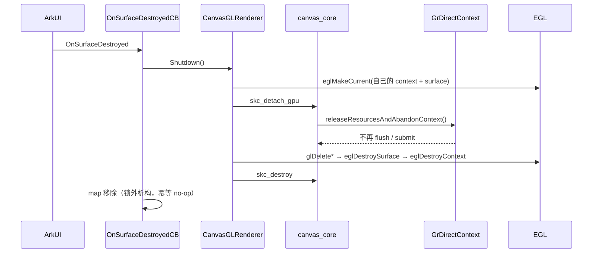

# 鸿蒙 APP_INPUT_BLOCK：CanvasGLView 销毁时卡死 GL 驱动

> 现象：鸿蒙真机（HUAWEI Mate 60 Pro / HarmonyOS 7.0.0）页面切换时应用卡住约 8 秒，
> 系统判定 `APP_INPUT_BLOCK` 并生成 appfreeze 日志。
>
> 结论：**不是崩溃，也不是 GC / 内存问题**。`CanvasGLView` 的 EGL 上下文先被销毁，
> Skia 的 `GrDirectContext` 之后才析构，其内部 `flush + submit` 在无合法 GL 现场时
> 阻塞在 `glGetError`，把 ArkTS 主线程（同时是 UI 线程）堵死。

- 日志：`build/tmp/appfreeze-com.edwin.glfwmobile-20261023171111.678.txt`
- 设备：HUAWEI Mate 60 Pro，`ALN-AL00 7.0.0.109(SP6C00E105R4P3)`
- 版本：`com.edwin.glfwmobile 1.0.0 (1000000)`，debug
- 触发：`17:11:02.756` 切到 `/ets/pages/Index`，同一时刻主线程开始执行 `uvLoopTask` 后不再返回

---

## 一、日志关键信息

```
Reason: APP_INPUT_BLOCK
Wait Event(1209) to be marked exceed 8000ms,
lastDispatchEvent(1185), lastProcessEvent(1185), lastMarkedEvent(1185)

Page switch history:
  17:11:02.756 /ets/pages/Index
  17:09:35.960 /ets/pages/Index
  17:09:34.560 :enters foreground

Main handler dump:
  Current Running: start at 2026-10-23 17:11:02.761,
  Event { task name = uvLoopTask, caller = [event_queue.cpp(HandleFileDescriptorEvent:313)] }

Tid:27341, Name:dwin.glfwmobile
state=R, utime=639, stime=14, priority=-54, nice=-10
```

可以先排除的几项：

| 维度 | 日志值 | 判断 |
| --- | --- | --- |
| GC | count 4，maxPause 27.71ms | 正常，不是 GC 停顿 |
| 内存 | Rss 183MB，Available 6.1GB | 正常，不是 OOM / 内存抖动 |
| 温度 | ThermalLevel 0 | 正常 |
| 主线程状态 | `state=R`，栈停在 `glGetError` | 在 GPU 驱动内自旋/等待，不是锁等待 |

`Wait Event(1209)` 与 `lastMarkedEvent(1185)` 相差 24 个事件，
说明主线程是被**某一个事件长时间占用**卡住的，而不是事件队列堆积。

---

## 二、符号解析

### 2.1 匹配产物

日志中 `libentry.so` 的 Build ID：

```
/data/storage/el1/bundle/libs/arm64/libentry.so(89bbfce366dd4b342d19eb5ee65fd13fdd87c6b6)
```

与本地构建产物完全一致（`ohosApp/entry/build/default/intermediates/cmake/default/obj/arm64-v8a/libentry.so`）：

```bash
/Applications/DevEco-Studio.app/Contents/sdk/default/openharmony/native/llvm/bin/llvm-readelf \
  -n ohosApp/entry/build/default/intermediates/cmake/default/obj/arm64-v8a/libentry.so \
  | grep "Build ID"
# Build ID: 89bbfce366dd4b342d19eb5ee65fd13fdd87c6b6
```

> 注意：必须用 **unstripped** 的 `cmake/default/obj/.../libentry.so`。
> `stripped_native_libs/` 下的产物没有符号表，解析不出来。

### 2.2 解析命令

```bash
A=/Applications/DevEco-Studio.app/Contents/sdk/default/openharmony/native/llvm/bin/llvm-addr2line
L=ohosApp/entry/build/default/intermediates/cmake/default/obj/arm64-v8a/libentry.so

"$A" -C -f -i -e "$L" \
  0x48fb9c 0x39ec14 0x36a404 0x36a694 \
  0x1ae490 0x1b5b4c 0x1b5500 0x1b5548 0x1b5578 \
  0x1afea8 0x1acaac 0x1aca08 0x1a2394 0x1a230c 0x1a2218 0x1a286c
```

日志里的 `pc` 是相对 ELF 的地址，可直接喂给 `llvm-addr2line`。

### 2.3 还原后的主线程栈

> 行号对应崩溃时（17:09）的构建产物；只保留关键帧。

```
#00 glGetError                                          libGLESv3.so
#01 GrGLGpu::onSubmitToGpu(GrSubmitInfo const&)         GrGLGpu.cpp
#02 GrGpu::submitToGpu(GrSubmitInfo const&)             GrGpu.cpp
#03 GrDirectContext::~GrDirectContext()                 GrDirectContext.cpp
#04 GrDirectContext::~GrDirectContext()
#05 SkRefCntBase::unref() const                         SkRefCnt.h:78
#06 SkSafeUnref<GrDirectContext>(GrDirectContext*)      SkRefCnt.h:151
#07 sk_sp<GrDirectContext>::~sk_sp()                    SkRefCnt.h:256
#08 GLGpuSurface::~GLGpuSurface()                       gpu_surface_gl.cpp:29
#09 GLGpuSurface::~GLGpuSurface()
#10 std::default_delete<skc::GpuSurface>::operator()
#11 std::unique_ptr<skc::GpuSurface>::reset()
#12 skc_destroy                                         canvas_core.cpp:57
#13 CanvasGLRenderer::~CanvasGLRenderer()               canvas_gl_render.cpp:75
#14 std::default_delete<CanvasGLRenderer>::operator()
#15 std::unique_ptr<CanvasGLRenderer>::reset()
#16 std::unique_ptr<CanvasGLRenderer>::~unique_ptr()
#17 std::pair<const std::string, std::unique_ptr<CanvasGLRenderer>>::~pair()
#18 OnSurfaceDestroyedCB                                canvas_gl_render.cpp:504
#27 XComponentPattern::OnSurfaceDestroyed               libace_compatible.z.so
#28 XComponentPattern::OnDetachFromFrameNode
#29 FrameNode::~FrameNode()
#34 ViewModel::DisposeNode
#35 NodeModel::DisposeNode                              libace_ndk.z.so
#36 ArkUINativeNodeAPI::disposeNode                     libkuikly.so
#39 NativeSafeAsyncWork::ProcessAsyncHandle             libace_napi.z.so
#40 uv__async_io                                        libuv.so
#42 uv_run
#47 MainThread::Start                                  libappkit_native.z.so
```

栈的语义非常明确：

```
ArkUI 销毁 XComponent FrameNode
  → OnSurfaceDestroyed 回调
    → 从全局 map 移除 renderer
      → ~CanvasGLRenderer
        → skc_destroy
          → ~GLGpuSurface
            → ~GrDirectContext   ← 在这里 flush/submit
              → glGetError       ← 卡住 8s+
```

---

## 三、根因

### 3.1 错误的释放顺序

修复前的 `~CanvasGLRenderer`：

```cpp
~CanvasGLRenderer() {
    DestroyGLResources();   // 1. 删除 program / texture / vbo / vao
    DestroySurface();       // 2. eglMakeCurrent(NO_CONTEXT) + eglDestroySurface
    Terminate();            // 3. eglDestroyContext + eglTerminate
    skc_destroy(core_);     // 4. 最后才释放 Skia GPU 上下文
}
```

创建顺序是：

```
EGLContext → GL program/texture → GrDirectContext + SkSurface
```

释放顺序却完全相反，第 3 步之后 EGL 上下文已经不存在，第 4 步 `GrDirectContext`
析构仍然会 **flush 并提交未完成的绘制**，于是：

- `GrGLGpu::onSubmitToGpu` 调用 GL 入口；
- 此时没有 current context（或 context 已被销毁）；
- 鸿蒙 GLES 驱动内部阻塞在 `glGetError`，主线程 8 秒不返回；
- 系统 watchdog 判定 `APP_INPUT_BLOCK`。

### 3.2 为什么 Android 没这个问题

Android 的 `GpuChild.destroy()` 是正确顺序，且明确注释了原因：

```kotlin
if (attached) {
    // GrDirectContext 的析构需要 GL 上下文，必须回到 GL 线程
    queueEvent {
        val h = handle
        handle = 0L
        CanvasNative.nativeDetachGpu(h)
        CanvasNative.nativeDestroy(h)
    }
    return
}
```

即：**先 detach（GL 线程、context current），再 destroy**。
鸿蒙侧漏掉了这一步，把两者合并进了析构函数，且顺序写反。

### 3.3 同时暴露的其它问题

| # | 问题 | 影响 |
| --- | --- | --- |
| 1 | `Terminate()` 调用了 `eglTerminate(display_)` | `EGLDisplay` 是进程级共享的，会连带销毁其它 XComponent 的上下文 |
| 2 | 多个画布共用 UI 线程，但没有 `makeCurrent` 保护 | 后创建的 `EGLContext` 会成为 current，旧画布可能操作到别人的上下文 |
| 3 | `OnSurfaceDestroyedCB` 使用 `GetOrCreateRenderer` | 销毁回调可能凭空创建一个 renderer 再立刻析构 |
| 4 | `RemoveRenderer` 在全局锁内执行析构 | 析构可能等待 GL 驱动，持锁期间阻塞其它 NAPI 调用 |
| 5 | GPU attach 失败后每帧重试 | 反复创建 / 析构 `GrDirectContext`，放大风险 |

---

## 四、修复方案

### 4.1 核心原则

> **GL 资源的释放顺序必须与创建顺序严格相反。**
>
> ```
> 创建：EGLContext → GL 对象 → GrDirectContext / SkSurface
> 释放：GrDirectContext / SkSurface → GL 对象 → EGLSurface → EGLContext
> ```

并且：**Skia GPU 上下文的释放必须发生在当前线程自己的 GL 现场下**。
现场不可用时，只能 `abandon`，不能发起任何 GL 调用。

### 4.2 鸿蒙渲染器：统一的 `Shutdown()`

`ohosApp/entry/src/main/cpp/canvas_gl_render.cpp` 新增幂等的 `Shutdown()`，
析构函数与 `OnSurfaceDestroyed` 都只调用它：

```cpp
void Shutdown() {
    if (shutDown_) {
        return;
    }
    shutDown_ = true;

    ReleaseGpuContext();            // 1. Skia：detach 或 abandon
    if (MakeCurrent()) {
        DestroyGLResources();       // 2. program / texture / vbo / vao
    }
    DestroySurface();               // 3. 解绑 + eglDestroySurface
    Terminate();                    // 4. eglDestroyContext
    if (core_ != nullptr) {
        skc_destroy(core_);
        core_ = nullptr;
    }
    std::vector<uint8_t>().swap(pixels_);
    width_ = 0;
    height_ = 0;
}
```

`ReleaseGpuContext()` 负责选择释放方式：

```cpp
void ReleaseGpuContext() {
    gpuAttached_ = false;
    if (core_ == nullptr) {
        return;
    }
    if (MakeCurrent()) {
        skc_detach_gpu(core_);      // 正常释放：Skia 回收自己的 GL 对象
    } else {
        skc_abandon_gpu(core_);     // 现场不可用：只丢引用，不碰任何 GL
    }
}
```

`MakeCurrent()` 修复多画布共用 UI 线程的上下文抢占：

```cpp
bool MakeCurrent() {
    if (display_ == EGL_NO_DISPLAY || context_ == EGL_NO_CONTEXT ||
        eglWindow_ == EGL_NO_SURFACE) {
        return false;
    }
    if (eglGetCurrentContext() == context_ &&
        eglGetCurrentSurface(EGL_DRAW) == eglWindow_) {
        return true;
    }
    return eglMakeCurrent(display_, eglWindow_, eglWindow_, context_) == EGL_TRUE;
}
```

`OnSurfaceDestroyed` 在 EGLSurface / EGLContext 仍然有效时完成全部释放：

```cpp
void OnSurfaceDestroyed() {
    // XComponent 销毁时 EGLSurface/Context 仍然有效，这是唯一能安全释放 Skia GPU 的窗口。
    Shutdown();
}
```

`Terminate()` 不再调用 `eglTerminate`：

```cpp
void Terminate() {
    if (display_ == EGL_NO_DISPLAY) {
        return;
    }
    if (context_ != EGL_NO_CONTEXT) {
        eglDestroyContext(display_, context_);
        context_ = EGL_NO_CONTEXT;
    }
    // 不调用 eglTerminate：EGLDisplay 是进程级共享的，会连带销毁其它 XComponent 的上下文
    display_ = EGL_NO_DISPLAY;
    config_ = nullptr;
}
```

### 4.3 canvas_core：不依赖“调用方记得先 detach”

`cppCore/canvasCore/src/gpu_surface_gl.cpp`：

```cpp
~GLGpuSurface() override {
    // 析构路径按「上下文可能已不可用」处理：不发起任何 GL 调用
    abandon();
}

void detach() override {
    if (context_ != nullptr) {
        // 默认析构会 flush + submit；Surface/EGL 即将销毁时会卡死驱动
        context_->releaseResourcesAndAbandonContext();
    }
    ReleaseSkiaHandles();
}

void abandon() override {
    if (context_ != nullptr) {
        context_->abandonContext();   // 只打标记，保证析构不发起任何 backend 调用
    }
    ReleaseSkiaHandles();
}
```

`gpu_surface.h` 增加带默认实现的 `abandon()`，`canvas_core.h/.cpp` 增加 `skc_abandon_gpu()`：

```c
/**
 * 放弃 GPU 上下文：不调用任何图形 API，只丢引用，允许在上下文已销毁/不可用的线程上调用。
 */
void skc_abandon_gpu(skc_canvas *canvas);
```

这样即使平台侧漏调 `skc_detach_gpu`，`skc_destroy` 也不会再因为
`GrDirectContext` 的默认析构而卡在驱动里。

### 4.4 全局 map 的生命周期

```cpp
CanvasGLRenderer *FindRenderer(const std::string &id) {
    std::lock_guard<std::mutex> lock(g_rendererMutex);
    const auto it = g_renderers.find(id);
    return it == g_renderers.end() ? nullptr : it->second.get();
}

void RemoveRenderer(const std::string &id) {
    std::unique_ptr<CanvasGLRenderer> removed;
    {
        std::lock_guard<std::mutex> lock(g_rendererMutex);
        const auto it = g_renderers.find(id);
        if (it == g_renderers.end()) {
            return;
        }
        removed = std::move(it->second);
        g_renderers.erase(it);
    }
    // removed 在锁外析构：Shutdown 可能等待 GL 驱动，不能占着全局锁
}
```

`OnSurfaceDestroyedCB` 改用 `FindRenderer`，销毁回调不再创建 renderer。

### 4.5 其它配套修改

- `OnSurfaceCreated` / `OnSurfaceChanged` / `DrawFrame` 入口统一 `MakeCurrent()`；
- `DrawFrame` 增加 `gpuAttachFailed_`，attach 失败后不再逐帧重试；
- `SetBackend(RASTER)` 立即回收 GPU 上下文，避免悬到 Surface 销毁之后；
- `Shutdown()` 幂等，析构 / Surface 销毁 / 重复回调都不会二次释放；
- iOS EAGL 的 `detach()` 存在同样的顺序问题，一并修正为
  “EAGLContext 仍 current 时 `releaseResourcesAndAbandonContext()`，再释放 FBO / renderbuffer”。

### 4.6 修复后的时序



---

## 五、改动文件

| 文件 | 改动 |
| --- | --- |
| `ohosApp/entry/src/main/cpp/canvas_gl_render.cpp` | 重写资源释放顺序；新增 `Shutdown` / `ReleaseGpuContext` / `MakeCurrent`；去掉 `eglTerminate`；销毁回调不重建 renderer；锁外析构；attach 失败不重试 |
| `cppCore/canvasCore/src/gpu_surface_gl.cpp` | `detach()` 改为 `releaseResourcesAndAbandonContext()`；新增 `abandon()`；析构默认走 abandon |
| `cppCore/canvasCore/src/gpu_surface.h` | 新增 `virtual void abandon()`（默认退回 `detach()`） |
| `cppCore/canvasCore/include/canvas_core.h` | 新增 `skc_abandon_gpu()` 声明与契约说明 |
| `cppCore/canvasCore/src/canvas_core.cpp` | 实现 `skc_abandon_gpu()` |
| `cppCore/canvasCore/src/gpu_surface_eagl.mm` | 修正 EAGL 下 Skia 与 FBO 的释放顺序 |

改动不涉及 scene 指令、绘制结果和上层 API，`skc_attach_gl` / `skc_render_gl` / `skc_render_raster` 的行为不变。

---

## 六、验证

### 6.1 编译校验

用 DevEco 自带 LLVM 对改动文件做语法检查（OHOS target + 本机 Skia 头文件）：

```bash
SDK=/Applications/DevEco-Studio.app/Contents/sdk/default/openharmony/native
CLANG=$SDK/llvm/bin/clang++

$CLANG --target=aarch64-linux-ohos -std=c++17 -fsyntax-only -Wall -Wextra \
  -I$SDK/sysroot/usr/include \
  -I$SDK/sysroot/usr/include/aarch64-linux-ohos \
  -IohosApp/entry/src/main/cpp \
  -IcppCore/canvasCore/include \
  ohosApp/entry/src/main/cpp/canvas_gl_render.cpp

$CLANG --target=aarch64-linux-ohos -std=c++17 -fsyntax-only -Wall -Wextra \
  -I$SDK/sysroot/usr/include \
  -I$SDK/sysroot/usr/include/aarch64-linux-ohos \
  -IcppCore/canvasCore/include -IcppCore/canvasCore/src \
  -Ivcpkg/installed/ohos/arm64-ohos/include/skia \
  -Ivcpkg/installed/ohos/arm64-ohos/include \
  cppCore/canvasCore/src/gpu_surface_gl.cpp \
  cppCore/canvasCore/src/canvas_core.cpp
```

### 6.2 真机回归

1. 重新执行 `hvigorw assembleHap` 并安装；
2. 反复执行“进入带画布页面 → 返回 → 再进入”，至少 20 次；
3. 同时覆盖：单页面多画布、页面快速连续切换、后台切前台、旋转 / 分屏改尺寸。

观察项：

- 不再出现 `APP_INPUT_BLOCK` / `THREAD_BLOCK_3S`；
- hilog（TAG `CanvasGLView`）无 `gpu attach failed`、`eglMakeCurrent failed`、`eglSwapBuffers failed`；
- 画布内容与切换动画和修复前一致。

若仍复现，抓实时栈确认是否仍在 `GrDirectContext` 析构路径：

```bash
hdc shell hidumper -s 4606 -a "-p <pid>"
```

---

## 七、复盘：GL 生命周期不变式

这套约束适用于所有持有 EGL / GL 的组件，后续新增画布或重构时要保持：

| # | 不变式 | 违反后的表现 |
| --- | --- | --- |
| 1 | 谁创建谁销毁，创建与销毁必须在同一线程 | GL 调用落到错误线程，驱动崩溃或卡死 |
| 2 | 释放顺序 = 创建顺序的逆序 | `GrDirectContext` 在无 context 时 flush，卡驱动 |
| 3 | 任何 GL 调用前必须 `makeCurrent`，并校验是自己的 context/surface | 操作到其它画布的 GL 对象 |
| 4 | 析构路径默认 `abandon`，显式释放才走 `detach` | 漏调 detach 时析构阻塞 |
| 5 | `EGLDisplay` 是进程级共享资源，单实例销毁不调用 `eglTerminate` | 其它画布上下文被一起销毁 |
| 6 | 释放期间不持有全局锁 | 长时间阻塞扩散到其它 NAPI 调用 |
| 7 | Surface 销毁回调内完成 GPU 释放，不要拖到对象析构 | EGL 已销毁后才释放 Skia，必然卡驱动 |

一句话总结：**Skia 的生命周期必须包在 EGL 的生命周期里面，不能反过来。**